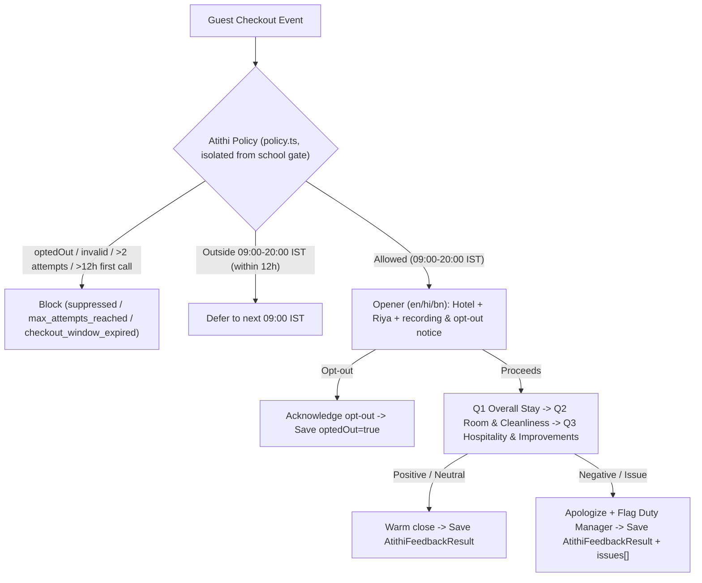

# AtithiVani — Post-Stay Feedback Call Specification (SP-10)

**Updated:** 2026-11-28  
**Status:** Spec + isolated Sampark module (`src/lib/sampark/atithivani/`) implemented. Pending live test calls on `$RIYA_REAL_TEST_NUMBER` and production deployment.

---

## 1. Isolation From School-Call Rules

AtithiVani hotel guest feedback calls are **strictly separate** from Sampark's school-to-parent policy (`src/lib/sampark/policy/gate.ts`, `catalogue.ts`, `window.ts`):
- School calling hours (`10:00–19:00 IST`, off-days, Friday/Saturday concern exclusions, student `custody_restriction`, guardian consent groups) **do not apply**.
- AtithiVani uses its own policy evaluator (`src/lib/sampark/atithivani/policy.ts`) and its own feedback store (`atithivani_feedback_results`), never writing to school `sampark_calls` or `parent_outreach`.
- Shared primitives reused: IST wall-clock helpers (`src/lib/sampark/policy/ist.ts`), test-phone allow-list safety, and global opt-out suppression.

---

## 2. Hotel-Guest Calling Rules

| Rule | Value | Enforcement |
|---|---|---|
| **Calling window** | `09:00–20:00 IST` | Calls outside `[09:00, 20:00)` IST are deferred to the next `09:00 IST` opening |
| **First-call deadline** | Within **12 hours** of checkout (`checkedOutAt`) | If `attemptCount === 0` and elapsed > 12h (or next `09:00 IST` opening falls past 12h), block (`checkout_window_expired`) |
| **Attempt cap** | **At most 2 calls** per guest after checkout | `attemptCount >= 2` → block (`max_attempts_reached`) |
| **Opt-out** | Respects guest / number opt-out | `optedOut === true` → block (`suppressed`) |
| **Test mode safety** | Test phone only (`$RIYA_REAL_TEST_NUMBER`) until live dial enabled | Non-test numbers blocked when `testMode === true` |

---

## 2b. Call Flow Diagram

---

## 3. Multilingual Call Script (`en`, `hi`, `bn`)

### Stage 1: Greeting + Recording Notice + Opt-Out
- **English (`en`):**  
  *"Hello {{guest_name}}, this is Riya calling from {{hotel_name}} regarding your recent stay. This call may be recorded for service quality, and you can ask not to be called anytime. Do you have one minute to share quick feedback?"*
- **Hindi (`hi`):**  
  *"नमस्ते {{guest_name}} जी, मैं {{hotel_name}} से रिया बोल रही हूँ आपके हाल के स्टे के बारे में। सेवा की गुणवत्ता के लिए यह कॉल रिकॉर्ड की जा सकती है, और आप कभी भी कॉल न करने के लिए कह सकते हैं। क्या आपके पास फीडबैक देने के लिए एक मिनट है?"*
- **Bengali (`bn`):**  
  *"নমস্কার {{guest_name}}, আমি {{hotel_name}} থেকে রিয়া বলছি আপনার সাম্প্রতিক থাকার অভিজ্ঞতা নিয়ে। পরিষেবার মানের জন্য এই কলটি রেকর্ড করা হতে পারে, এবং আপনি যেকোনো সময় কল না করার কথা বলতে পারেন। একটু মতামত দেওয়ার জন্য কি এক মিনিট সময় হবে?"*

### Stage 2: Feedback Questions (3–4 short turns)
1. **Overall stay:**  
   - `en`: *"How was your overall stay with us—on a scale of 1 to 5, or in your own words?"*  
   - `hi`: *"आपका पूरा अनुभव कैसा रहा—1 से 5 के बीच या अपने शब्दों में बताइए?"*  
   - `bn`: *"আপনার সামগ্রিক থাকার অভিজ্ঞতা কেমন ছিল—১ থেকে ৫-এর মধ্যে বা নিজের কথায় বলবেন?"*
2. **Room & cleanliness:**  
   - `en`: *"Were your room, cleanliness, and check-in comfortable?"*  
   - `hi`: *"क्या कमरा, सफाई और चेक-इन का अनुभव आरामदायक था?"*  
   - `bn`: *"ঘর, পরিচ্ছন্নতা এবং চেক-ইন কি আরামদায়ক ছিল?"*
3. **Hospitality & dining / improvements:**  
   - `en`: *"Is there anything our team did well, or anything we could improve for your next visit?"*  
   - `hi`: *"क्या कोई ऐसी बात है जो हमारी टीम ने अच्छी की, या अगली बार हम क्या बेहतर कर सकते हैं?"*  
   - `bn`: *"আমাদের টিমের কোন কাজটি ভালো লেগেছে, বা পরের বার আমরা কী আরও ভালো করতে পারি?"*

### Stage 3: Closing
- **Positive / neutral close:**  
  - `en`: *"Thank you so much for your time, {{guest_name}}. We have saved your feedback for the {{hotel_name}} team and hope to welcome you back soon."*  
  - `hi`: *"आपके समय के लिए बहुत धन्यवाद, {{guest_name}} जी। हमने आपका फीडबैक {{hotel_name}} टीम के लिए सेव कर लिया है। फिर स्वागत करने की उम्मीद करते हैं।"*  
  - `bn`: *"আপনার সময়ের জন্য অনেক ধন্যবাদ, {{guest_name}}। আমরা আপনার মতামত {{hotel_name}} টিমের জন্য সংরক্ষণ করেছি। আবার স্বাগত জানানোর আশা রাখি।"*
- **Issue recovery close (if negative issue raised):**  
  - `en`: *"I'm sorry about that, {{guest_name}}. I have flagged this for the {{hotel_name}} duty manager right away. Thank you for letting us know."*  
  - `hi`: *"इस असुविधा के लिए क्षमा चाहते हैं, {{guest_name}} जी। मैंने यह तुरंत {{hotel_name}} के ड्यूटी मैनेजर को भेज दिया है। बताने के लिए धन्यवाद।"*  
  - `bn`: *"এই অসুবিধার জন্য দুঃখিত, {{guest_name}}। আমি এটি এখনই {{hotel_name}}-এর ডিউটি ম্যানেজারকে জানিয়ে দিচ্ছি। জানানোর জন্য ধন্যবাদ।"*

---

## 4. Saved Feedback Schema

Each completed call saves an `AtithiFeedbackResult` record containing `callId`, `hotelId`, `stayId`, `guestId`, `language`, `carrier`, `overallRating` (`1..5 | null`), `sentiment` (`positive | neutral | negative`), `roomCleanliness`, `hospitality`, `highlights[]`, `issues[]`, `callbackRequested`, `optedOut`, `recordingUrl`, and `savedAt`.
