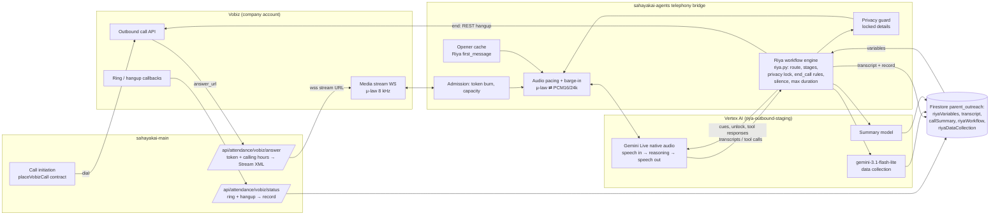
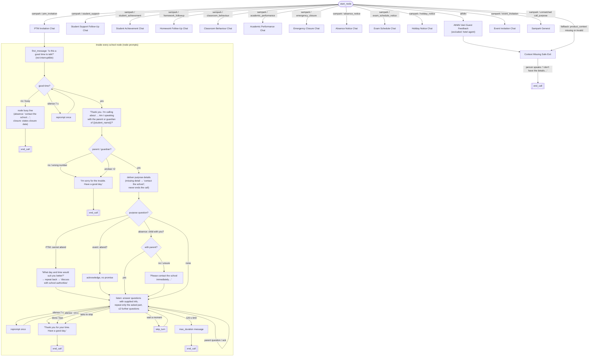

# Riya workflow on Vobiz (no ElevenLabs) — 2026-11-07

Branch `feat/parent-call-voice-upgrade` (worktree `call-bridge-wt`), uncommitted.
Source of truth: the ElevenLabs export `riyajson.txt` ("Riya SARGVISION Unified",
version `agtvrsn_0601m6hcy8x9fgksafvk9080h920`).

## 1. Inventory of the exported Riya workflow

| # | Component | What the export says | Where it lives now |
|---|---|---|---|
| 1 | Identity / personality | Riya, AI calling assistant for `{{school_name}}`; warm, concise, Indian English; honest if asked about being an AI | `base_prompt` in `riya_workflow.json`, verbatim |
| 2 | System prompt | 12.5k-char base prompt (13 sections) | same, rendered per call |
| 3 | Opening | `first_message`, not interruptible: "Hello, I'm Riya, an AI assistant calling on behalf of {{school_name}}… Is this a good time to talk?" | pre-rendered in the call's own voice (`render_riya_opener.py`), barge-in suppressed while it plays |
| 4 | Stages | per node: availability → guardian check → deliver → listen/clarify → (purpose follow-up) → close | prompt (model) + `RiyaStage` in `riya.py` (code) |
| 5 | Workflow nodes | `start_node` + 14 `override_agent` nodes (11 school purposes, `Sampark General`, `Context Missing Safe Exit`, `Athithi Vani Guest Feedback`) | 13 nodes migrated; Athithi excluded (hotel agent, not Riya) |
| 6 | Transitions | 14 start edges on `product_context` + `call_purpose`, in `edge_order`; fallback unconditional | `route()` (exact order) |
| 7 | Conditional branches | busy / not now; wrong person; cannot verify; purpose-specific (PTM cannot attend → preferred time; absence child not with parent; closure child at school …) | busy/wrong/unverified/stop in code; purpose branches in the node prompts |
| 8 | Questions | availability, guardian, ≤2 further questions per call | prompt + `questions_after_verification` budget note |
| 9 | Intent recognition | LLM-only in ElevenLabs | deterministic classifiers for availability / identity / stop / goodbye / repeat / AI-question (`riya.py`); the model handles the rest |
| 10 | Dynamic variables | 19 (`school_name`, `student_name`, `call_purpose`, `class_name`, `section_name`, event/holiday/exam/absence/closure/transport, `academic_update`, `behaviour_summary`, `assignment_details`, `achievement_details`, `followup_details`, `product_context`) | `riyaVariables` + `productContext` on the outreach record; empty renders empty |
| 11 | Tools | system `end_call` (long CALL / NEVER CALL rules), system `skip_turn` | both declared to Gemini Live; validated server-side |
| 12 | Tool conditions | end_call only on completion, explicit end, busy, wrong person | `RiyaCall.may_end()` |
| 13 | Knowledge base | none (empty) | — |
| 14 | Memory / context | per-call variables only; no cross-call memory | same |
| 15 | Interruptions | allowed except during first message | local barge-in + Live interruption; first message protected |
| 16 | Silence | `turn_timeout` 7 s, `silence_end_call_timeout` 15 s, soft timeout off | `on_silence()`: one reprompt at 7 s, close by ~15 s |
| 17 | Error recovery | prompt: "say it again", "contact the school" for missing data; missing data never ends the call | prompt + end_call validation |
| 18 | Escalation | no transfer tool configured; escalation = "Please contact the school" | same (no transfer) |
| 19 | Goodbye / termination | "Thank you for your time. Have a good day." then end_call once; max 120 s with its own message | farewell net + validated end_call; `max_duration_seconds` + message (60 s for the test) |
| 20 | Opt-out / wrong number | stop → acknowledge and end; wrong person → "I'm sorry for the trouble. Have a good day." | `stop` / `wrong_person` branches |
| — | Data collection | 9 fields (`good_time_to_talk`, `ptm_*`×3, `event_attendance`, `late_return_date`, `exam_absence_date`, `expected_return_date`, `child_at_school_during_closure`) | post-call extraction with Riya's own LLM `gemini-3.1-flash-lite`, enum-validated → `riyaDataCollection` |

Dropped on purpose (ElevenLabs runtime only): voice ids, Eleven TTS/ASR settings,
widget, phone numbers, access settings.

## 2. Implementation

| File | Change |
|---|---|
| `sahayakai-agents/scripts/extract_riya_workflow.py` | new: export → `riya_workflow.json` (Riya only) |
| `sahayakai-agents/src/sahayakai_agents/telephony/riya_workflow.json` | new, generated |
| `sahayakai-agents/src/sahayakai_agents/telephony/riya.py` | new: routing, variable rendering + locking, stage engine, classifiers, end_call rules, silence, data-collection fields, record |
| `sahayakai-agents/src/sahayakai_agents/telephony/router.py` | Riya path when `agentWorkflow == "riya"`: Live config (native audio, en-IN), cached opener, debounced utterance judging, unlock cue, close net, tool validation, watchdog (silence + duration), Riya privacy guard, post-call persistence |
| `sahayakai-agents/scripts/render_riya_opener.py` | new: pre-render the opener in the call voice |
| `sahayakai-agents/tests/unit/test_telephony_riya.py` | new: 90+ tests |
| `sahayakai-main/src/app/api/attendance/vobiz/answer/route.ts` | adds `&agent=riya` to the stream URL for Riya records |

Speech stack: Gemini Live `gemini-live-2.5-flash-native-audio` (us-central1, voice
`Aoede`, en-IN transcription) on Vertex project `riya-outbound-staging`.
Not available: the Sarvam cascade (no `SARVAM_API_KEY` outside the company GCP
project), Google Cloud STT/TTS (APIs not enabled; enabling is a new paid API).

## 3. Diagrams

### A — Architecture

### B — Riya conversation workflow (from `riyajson.txt`)

No transfer or escalation tool is configured in the export; "escalation" is the
prompt's "Please contact the school" line.

## 4. Test results

- `tests/unit/test_telephony_riya.py` + `test_telephony_flow.py`: 200 passed.
- Full telephony suite: see the session report (4 `only_surface` failures are the
  known local FastAPI baseline).
- Local end-to-end (fake Vobiz leg → real bridge → real Gemini Live, synthetic
  speech): PTM path verified — volunteered guardian → unlock → correct details →
  cannot attend → "What day and time would suit you better?" →
  `ptm_preferred_time = "Saturday morning"`. Found and fixed: model invented
  details while locked; declined end_call was spoken aloud after the time limit.

## 5. Real call (one call, Alyssa's own number …9732)

| Item | Result |
|---|---|
| Account | company Vobiz (Auth ID `MA…EH`, caller ID …3645) |
| Call UUID | `fdec5de6-e060-4149-8c01-9318878b44c7` |
| Rang / answered | 20:37:51 / 20:37:58 IST |
| Opening | correct Riya first message, from cache, 1.3 s after the socket opened |
| Recognition | "Yes, tell me", "Hello", "Yeah, now I can", "What are you here to call to me about?" correct; one garbled fragment |
| Workflow | availability → yes; guardian question **muted** (privacy guard bug) → reprompt → time limit |
| Tools | `skip_turn` 1; `end_call` accepted once (max_duration) |
| Duration / cost | 67 s billed, US$0.76 |
| Saved | transcript, summary, `riyaWorkflow`, `riyaDataCollection` |

**Bug found on the call:** VIDYA's privacy guard protects the child's name, but
Riya's guardian question names the child by design, so the guard silenced it
(`telephony.privacy_block where=live`, twice). Fixed after the call:
`_riya_protected()` guards only the locked purpose details (regression test
added). Not re-tested on a phone (one call only).

## 6. Remaining limitations

- Needs one more authorised handset call to confirm the guard fix and the full PTM branch on a real line.
- 60 s test cap minus a 10.8 s opener leaves little time; Riya's own cap is 120 s.
- Native-audio voice pitch can drift within a session (noted in `router.py`); not yet measured on this voice.
- Not run against the Sarvam cascade (no key) or Google STT/TTS (not enabled).
- `riya_workflow.json` contains the company's Riya prompts; `sargupta/sahayakai` is public — decide before committing.
- Lint: new code trips a few ruff style rules (statement counts, line length); not cleaned yet.
- The call record's `callStatus` stays as the status route leaves it on this branch (separate known issue).
