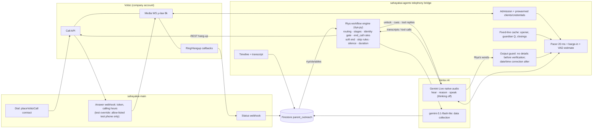
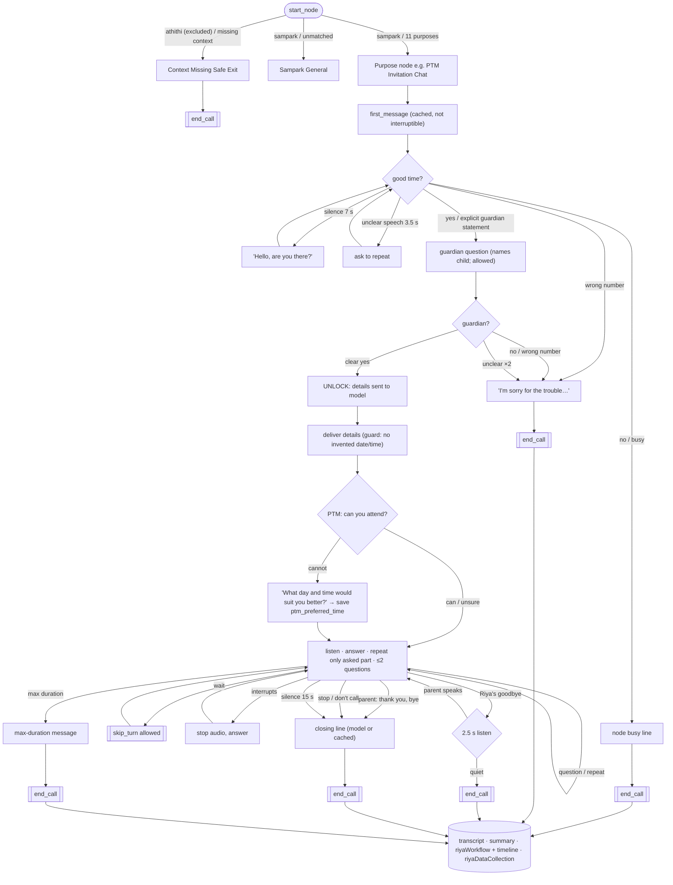

# Riya on Vobiz — conversation repair (2026-11-07, evening)

Branch `feat/parent-call-voice-upgrade` (worktree `call-bridge-wt`), uncommitted.
Follows `RIYA_ON_VOBIZ_2026-11-07.md`. Nothing deployed; no call placed during this work.

## 1. What happened on the failed call (Vobiz `fdec5de6-e060-4149-8c01-9318878b44c7`)

Reconstructed from the bridge log (times IST, socket open 20:37:58.72):

| t (s) | event |
|---|---|
| 0.00 | socket admitted (answer → socket 720 ms) |
| 0.10 | context loaded, PTM node routed |
| ~1.3 | opener starts (a ~1.2 s event-loop stall delayed it) |
| 3.45 | Gemini Live connected |
| ~12.0 | opener ends |
| 14.8 | parent transcript "Yes, tell me." → stage `availability_ok` |
| **17.3** | **`privacy_block where=live`**: Riya's guardian question ("…parent or guardian of Aarav?") muted by VIDYA's guard (child's name is a protected term) |
| 24.5 | 7 s of silence → reprompt "Can you hear me?" |
| 40.2 | parent "because, I came into, I love you" (garbled), "Hello.", "Yeah, now I can." |
| **48.1** | **second `privacy_block`**: guardian question muted again |
| 51.5 | 60 s cap minus 9 s → max-duration message, end_call accepted |
| 57.5 | parent "What are you here to call to me about?" — into a closing call |
| 67 | hang-up (NORMAL_CLEARING via API), US$0.76 |

**Why it stayed silent:** the privacy guard muted the guardian question both times;
because the muted text was discarded, the workflow never saw the question asked, so
the parent's "yes" could not verify anything. **Why replies were missed/misread:** the
first reply arrived after a mute; later replies were transcribed with Hindi/Kannada
hints active on English speech (garbled), and the 60 s cap (minus a 10.8 s opener)
ended the call before recovery.

## 2. Root causes found and fixed (all reproduced in synthetic-audio runs first)

| # | Root cause | Fix |
|---|---|---|
| 1 | VIDYA guard protects the child's name; Riya's verification question needs it | Riya guard (`_riya_check_output`): before verification blocks dates/times/numbers/section/marks and locked values, **allows** the guardian question; a blocked line is replaced by a cue to ask the guardian question (never dead air) |
| 2 | My first guard matched "Am" in "Am I speaking…" as a time | times caught by digits only; regression test |
| 3 | Model invented meeting details while locked | locked prompt forbids any detail; after unlock, dates/times not in the record trigger a correction cue (`detail_mismatch`) |
| 4 | Pacer stall 0.9–3.6 s at every call start (opener late, "awkward silence") | Vertex client built with pre-refreshed credentials **off** the event loop (google-genai refreshed ADC synchronously in `live.connect`); Firestore/Vertex clients cached; pre-warmed at bridge start. Now worst lateness 1–86 ms, 0 resyncs, opener 0–31 ms after socket |
| 5 | Goodbye accepted while still playing; parent's next question hit a dead line | soft end: goodbye plays, then 2.5 s of listening; if the parent speaks the call continues and the model is told so |
| 6 | end_call judged on the debounced (stale) parent verdict | judged on the parent's latest words and the turn still being spoken |
| 7 | model used `skip_turn` when it did not understand → silence | skip only when the parent asked to wait or is confirming as guardian; otherwise refused with "reply now" |
| 8 | short "I'm busy." not treated as speech by Live | Live VAD start sensitivity HIGH; bridge fallback: if the parent spoke and nothing came back in 3.5 s, Riya asks them to repeat |
| 9 | model sometimes ended without speaking the closing line | Riya's fixed lines (busy, wrong person, closing, max-duration, safe exit, guardian question, opener) pre-rendered in the call voice and played by the bridge when needed |
| 10 | "thinking" on the native-audio model: 4–7 s silences | `thinking_budget=0` for Riya |
| 11 | Live connect hung 28 s then failed (1006) under load | 8 s connect deadline + one retry |
| 12 | Hindi/Kannada transcription hints turned English into Devanagari | transcription `en-IN` (Riya speaks English only); data fields normalised to English |
| 13 | A garbled transcript containing "ha" verified a guardian | verification needs a clear yes / explicit guardian statement; loose words only answer "good time to talk?" |

## 3. Files changed

- `sahayakai-agents/src/sahayakai_agents/telephony/riya.py` — workflow engine (classifiers incl. Hindi/Kannada, guards, end_call rules with latest-words check, soft end, skip rules, fixed lines, PARENT_DONE).
- `sahayakai-agents/src/sahayakai_agents/telephony/router.py` — Riya path: guard, timeline (`riyaWorkflow.timeline`), VAD estimate, cached lines, soft end, close net, connect retry, thinking off, VAD config, off-loop clients + credentials, prewarm, unheard-speech fallback.
- `sahayakai-agents/scripts/render_riya_opener.py` — renders all fixed lines, trims edge silence.
- `sahayakai-agents/tests/unit/test_telephony_riya.py` — 139 tests.
- `sahayakai-main/src/lib/vobiz/test-hours-override.ts` + test — test-only calling-hours override.
- `sahayakai-main/src/app/api/attendance/vobiz/answer/route.ts` — applies that override; `&agent=riya`.

Not touched: Sampark (`src/lib/sampark/**`, `src/app/api/sampark/**`), the ElevenLabs Riya integration, production config.

## 4. Test-time restrictions

- Calling hours: production unchanged (09:00–21:00 IST). Override only when ALL hold: `VOBIZ_TEST_HOURS_OVERRIDE=1`, `NODE_ENV !== 'production'`, record `testCall: true`, no campaign/batch/notice id, number in `VOBIZ_TEST_HOURS_ALLOWLIST`. 7 Jest tests.
- Duration: `VOBIZ_RIYA_MAX_SECONDS=180` for the test (Riya default 120); hard bridge guard 200 s.

## 5. Synthetic-audio conversation tests

Fake Vobiz leg → real bridge → real Gemini Live; parent speech generated by Gemini (voice Kore, not Riya's).
Recordings (L = parent, R = Riya) and full timelines: `E:\sargvision\riya-tests\*.wav|*.txt`.

Final sweep (all 10 end on the correct branch):

| Scenario | Outcome |
|---|---|
| ptm_full | good time → guardian → correct details (5 B, 14 Nov, 10 AM) → cannot attend → "What day and time would suit you better?" → `ptm_preferred_time = Saturday morning` → **after goodbye "Can you repeat the date?" → "The meeting is on the 14th of November."** → bye → closing |
| opening_unclear | "Hello?", "Can you hear me?" → re-asks; "Please repeat that." → repeats date/time |
| interrupt | parent cuts in mid-delivery → Riya stops, answers "which class?" → bye |
| noisy_short | noisy reply → "could you please say that again?" → recovers |
| busy | busy line, close (even when the transcript garbled "busy") |
| wrong_number | "I'm sorry for the trouble. Have a good day." |
| do_not_call | acknowledged, closed |
| silence | one "Hello, are you there?" then closing line |
| hindi | "हां, बताइए" / "हां, मैं उसकी मां हूं" → verified, details in English |
| kannada | transcripts unusable → fails safe (unverified close, nothing disclosed) |

## 6. Measured latency (final sweep, 30 parent turns, local bridge, us-central1 Live)

| Metric | p50 | p90 | max |
|---|---|---|---|
| end of parent speech → transcript | 547 ms | 766 ms | 10.6 s (noisy clip) |
| end of parent speech → first reply audio at the carrier | 1.41 s | 2.25 s | 5.0 s |
| answer → opener audio | 0–31 ms | | |
| pacer worst frame lateness per call | 8–12 ms (86 ms max) | | |

"Last generated chunk → playback complete" is p50 ~4 s by design: Live generates
faster than real time, so audio is still PLAYING when generation finishes; no
underruns (0 resyncs, 0 stale frames).

The guardian-confirmation reply (~2.1 s) is the slowest regular turn: 0.5 s debounce
+ unlock cue + generation.

## 7. Suites

- `test_telephony_riya.py` 139 passed; telephony suite 710 passed, 4 failed (`test_telephony_only_surface`, known local FastAPI baseline).
- Jest `src/__tests__/lib/vobiz/`: override tests pass; `quiet-hours.test.ts` (status route) fails on this branch without my change (pre-existing).

## 8. Provider limitations (honest)

- Gemini Live native audio (`gemini-live-2.5-flash-native-audio`, us-central1) is the best available model here: natural voice, model-side barge-in, English and Hindi fine.
- **Kannada is not usable**: transcription is garbage at 8 kHz; Riya fails safe but cannot hold a Kannada conversation.
- Pitch drift of native audio across turns not measured on a handset yet.
- No Sarvam key; Google STT/TTS not enabled (would be a new paid API).
- Live connect itself takes 2–3 s; covered by the cached opener (10.7 s).

## 9. Diagrams

### A — Architecture

### B — Riya conversation workflow (nodes from `riyajson.txt`, branches as implemented)

## 10. Real handset call after the repair (21:55 IST, test-hours override)

Vobiz request `34f8f50e-d437-4752-a68b-5293ab5118d7` (CDR to …9732), company account
(Auth ID `MA…EH`, caller ID …3645). Answered 21:55:29, 76 s billed, US$0.76,
hang-up via API (NORMAL_CLEARING).

| | |
|---|---|
| Opener | 219 ms after the socket opened; pacer worst lateness 9 ms, 0 resyncs, 0 privacy blocks |
| Flow | "Here tell me." → guardian question → "You are?" (misheard) → "Sorry, I didn't catch that…" → "Yes, you are." → **verified** → correct details (Class 5, Section B, 14 Nov, 10 AM) → "No, I would not be." → "What day and time would suit you better?" → "8th November, 5:00 p.m." → authorities line + goodbye |
| Saved | `ptm_attendance = cannot_attend`, `ptm_preferred_time = "8th November, 5:00 p.m."`, transcript, summary, timeline |
| Reply latency (parent speech end → Riya audio) | 1.17 s, 1.38 s, 1.83 s (unlock), 1.02 s, 1.00 s |
| Defect | after Riya's goodbye the parent said "Okay." / "Hello." and heard ~10 s of silence before the closing line (the model kept calling end_call without speaking) |

Fixed afterwards (synthetic-audio verified, not yet on a handset): after a cancelled
soft end, a second silent end_call plays Riya's closing line at once (0.7 s in the
`post_goodbye_ack` scenario); the skip_turn refusal no longer nudges the model
towards "please repeat".
