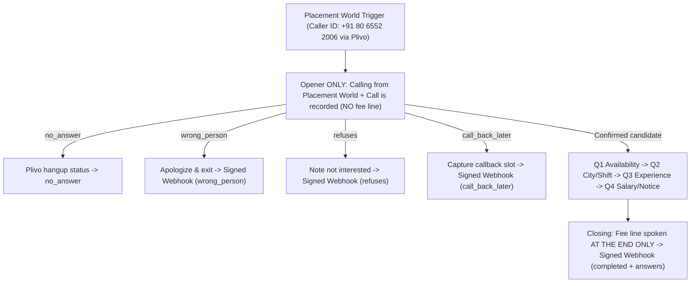

# Placement World — Screening Call Specification (SP-11)

**Updated:** 2026-11-28  
**Status:** Spec + Sampark flow (`src/lib/sampark/placement-world/`) implemented.  
**Pending:** Client's recorded screening calls (not present in repository/workspace; current question order uses standard screening structure and must be aligned once recordings are reviewed), native Hindi/Bengali line review, and 3 live test calls on `+91 7384273605` via Plivo (`+91 80 6552 2006`).

---

## 1. Strict Call Rules

1. **Opener constraint:** The opener must say **only** that Riya is calling from **Placement World** and that **the call is recorded**. No role pitch, salary, or fee line is spoken in the opener.
2. **Fee line placement:** Any Placement World service/registration fee disclosure stays strictly at the **end of the call** (closing stage), never upfront.
3. **Caller ID:** Outbound Plivo calls use `+91 80 6552 2006` (`918065522006` on Plivo's wire format).
4. **Webhook delivery:** Structured screening answers and terminal edge-case status are posted via HMAC-SHA256 signed JSON webhook (`X-Placement-Signature`).

---

## 2. Flow & Edge Cases

---

## 3. Multilingual Lines (`en`, `hi`, `bn`)

> **Review note:** Hindi (`hi`) and Bengali (`bn`) translations below require native-speaker review before production rollout (SP-11 subtask 5).

### Opener (Placement World + Recorded Notice ONLY)
- **English (`en`):**  
  *"Hello, this is Riya calling from Placement World. Please note that this call is being recorded. Am I speaking with {{candidate_name}}?"*
- **Hindi (`hi` — needs native review):**  
  *"नमस्ते, मैं प्लेसमेंट वर्ल्ड से रिया बोल रही हूँ। कृपया ध्यान दें कि यह कॉल रिकॉर्ड की जा रही है। क्या मेरी बात {{candidate_name}} से हो रही है?"*
- **Bengali (`bn` — needs native review):**  
  *"নমস্কার, আমি প্লেসমেন্ট ওয়ার্ল্ড থেকে রিয়া বলছি। অনুগ্রহ করে জানবেন যে এই কলটি রেকর্ড করা হচ্ছে। আমি কি {{candidate_name}}-এর সাথে কথা বলছি?"*

### Screening Questions (Fixed Order)
1. **Q1 (Availability):**  
   - `en`: *"Are you currently looking for a job change or available for interviews this week?"*  
   - `hi`: *"क्या आप अभी नई नौकरी की तलाश में हैं और इस सप्ताह इंटरव्यू के लिए उपलब्ध हैं?"*  
   - `bn`: *"আপনি কি বর্তমানে নতুন চাকরির সন্ধান করছেন এবং এই সপ্তাহে ইন্টারভিউয়ের জন্য উপলব্ধ আছেন?"*
2. **Q2 (Location & Shift):**  
   - `en`: *"Which city or work location do you prefer, and are you comfortable with standard shift timings?"*  
   - `hi`: *"आप किस शहर या लोकेशन में काम करना पसंद करेंगे, और क्या आप सामान्य शिफ्ट समय के लिए तैयार हैं?"*  
   - `bn`: *"আপনি কোন শহর বা লোকেশনে কাজ করতে পছন্দ করবেন, এবং সাধারণ শিফটের সময়ে কাজ করতে কি আপনি স্বাচ্ছন্দ্যবোধ করেন?"*
3. **Q3 (Experience):**  
   - `en`: *"Could you briefly share your total work experience and your current or last role?"*  
   - `hi`: *"कृपया अपना कुल कार्य अनुभव और अपनी वर्तमान या पिछली भूमिका संक्षेप में बताएं?"*  
   - `bn`: *"আপনার মোট কাজের অভিজ্ঞতা এবং বর্তমান বা শেষ পদটি সংক্ষেপে বলবেন?"*
4. **Q4 (Compensation & Notice Period):**  
   - `en`: *"What is your expected monthly salary, and how soon could you join if selected?"*  
   - `hi`: *"आपकी अपेक्षित मासिक सैलरी क्या है, और चयन होने पर आप कितने दिनों में जॉइन कर सकते हैं?"*  
   - `bn`: *"আপনার প্রত্যাশিত মাসিক বেতন কত, এবং নির্বাচিত হলে আপনি কত দিনের মধ্যে জয়েন করতে পারবেন?"*

### Edge Cases
- **`wrong_person`:**  
  - `en`: *"Sorry for the disturbance. I had the wrong contact. Have a good day."*  
  - `hi`: *"असुविधा के लिए क्षमा चाहते हैं, शायद गलत नंबर लग गया। आपका दिन शुभ हो।"*  
  - `bn`: *"অসুবিধার জন্য দুঃখিত, সম্ভবত ভুল নম্বরে কল হয়ে গেছে। ভালো থাকবেন।"*
- **`call_back_later`:**  
  - `en`: *"No problem at all. When would be a better time for Placement World to call you back?"*  
  - `hi`: *"कोई बात नहीं। प्लेसमेंट वर्ल्ड से आपको किस समय दोबारा कॉल करना सही रहेगा?"*  
  - `bn`: *"কোনো অসুবিধা নেই। প্লেসমেন্ট ওয়ার্ল্ড থেকে কখন আপনাকে আবার কল করলে সুবিধা হবে?"*
- **`refuses`:**  
  - `en`: *"Understood, I will mark that you are not interested right now and won't trouble you further. Thank you."*  
  - `hi`: *"समझ गई, मैं नोट कर लेती हूँ कि आप अभी इच्छुक नहीं हैं और आगे परेशान नहीं करेंगे। धन्यवाद।"*  
  - `bn`: *"বুঝেছি, আমি নোট করে নিচ্ছি যে আপনি এখন আগ্রহী নন এবং আর বিরক্ত করা হবে না। ধন্যবাদ।"*
- **`no_answer`:** Handled by carrier status (`plivoRingFailure` → `no-answer`); no speech delivered.

### Closing (Fee Line at the END Only)
- **English (`en`):**  
  *"Thank you for sharing those details, {{candidate_name}}. Please note that Placement World charges {{fee_terms}} only as per our candidate policy after placement details are confirmed. Our team will reach out with matching openings shortly."*
- **Hindi (`hi` — needs native review):**  
  *"जानकारी साझा करने के लिए धन्यवाद, {{candidate_name}} जी। कृपया ध्यान दें कि प्लेसमेंट वर्ल्ड की नीति के अनुसार {{fee_terms}} लागू होता है। हमारी टीम जल्द ही उपयुक्त अवसरों के साथ संपर्क करेगी।"*
- **Bengali (`bn` — needs native review):**  
  *"তথ্য দেওয়ার জন্য ধন্যবাদ, {{candidate_name}}। অনুগ্রহ করে জেনে রাখুন প্লেসমেন্ট ওয়ার্ল্ডের নীতি অনুযায়ী {{fee_terms}} প্রযোজ্য। আমাদের টিম শীঘ্রই উপযুক্ত চাকরির খবর নিয়ে যোগাযোগ করবে।"*
