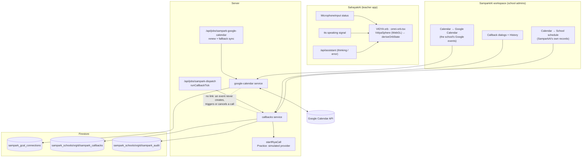

# Google Calendar, the VIDYA orb and parent callbacks: how they fit

These are three separate capabilities with three separate records. This page shows the
boundaries. Detail lives in:

- [GOOGLE_CALENDAR.md](GOOGLE_CALENDAR.md): OAuth, tokens, events, recurrence, sync,
  push, setup;
- [CALLBACKS.md](CALLBACKS.md): the callback lifecycle, scheduler, retries, audit;
- [../VIDYA_ORB.md](../VIDYA_ORB.md): rendering and state wiring.

## Rules that hold across all three

1. **Tenancy.**
   - Google connections are keyed by `orgId`; callbacks and audit live under
     `sampark_schools/{orgId}`.
   - Every route runs `guardOrgRoute` (or `guardRiyaRoute`): Sampark flag → 401 → 400 →
     403 org admin.
2. **No client-side secrets.**
   - Google tokens are encrypted and bound to the orgId; the browser never sees them.
   - Parent phone numbers are encrypted and only shown as their last four digits.
3. **Calls only from the scheduler.**
   - Browsers schedule, move or cancel callbacks. Only the server's tick starts a call,
     after re-checking every rule at that moment.
   - Locally the provider is the simulated one, and real callbacks need
     `SAMPARK_CALLBACKS_REAL_PROVIDER=true` plus Test mode.
4. **Calendar events are not callbacks.** No code path connects the Google Calendar
   service to the callback service.
5. **The orb shows only real states.** "Speaking" means audio is playing; "listening"
   means the mic is recording.

## Scheduling infrastructure (reused, not duplicated)

- Cloud Scheduler (production) or `scripts/sampark/ticker.ts` (local, 30 s) posts to the
  `/api/jobs/*` routes with `CRON_SECRET`.
- Callbacks: the existing `sampark-dispatch` job runs `runCallbackTick`. It uses
  Firestore leases and a single-flight lock, and survives restarts because the queue is
  the Firestore `queueAt` field, not memory.
- Google Calendar: a new `sampark-google-calendar` job, on the same scheduler and the
  same secret.
