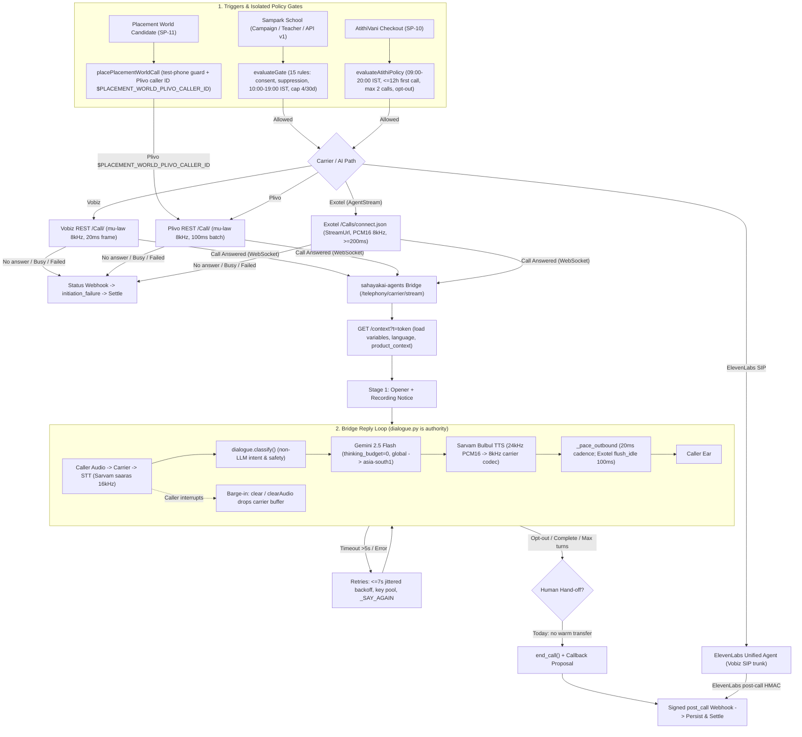
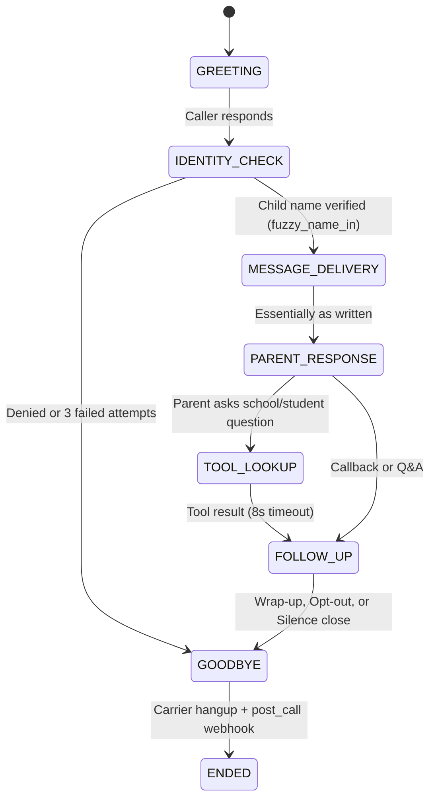
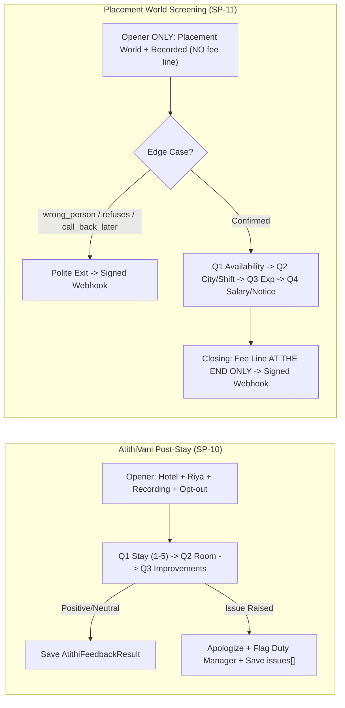

# SamparkAI Call Flow — Unified Architecture & Lifecycle Diagrams

**Updated:** 2026-11-28  
**Scope:** End-to-end call flows across **Sampark School Calling**, **AtithiVani Post-Stay**, and **Placement World Screening**, spanning `sahayakai-main` (Next.js) + `sahayakai-agents` (Python bridge) + **Vobiz | Plivo | Exotel | ElevenLabs**.

---

## 1. Unified Multi-Product & Multi-Carrier Call Flow

---

## 2. State Machine & Turn Authority (`dialogue.py` — School Calls)

---

## 3. Product-Specific Flows (AtithiVani & Placement World)

---

## 4. Key Architecture Notes & Exotel P1 Fixes

1. **P0 (Resolved on `main` via PR #221):** PR #230 used `Url` (ExoML), which Exotel AgentStream ignores (`Duration` is null). `main` uses `StreamUrl` + `StreamType=bidirectional` + `Call.Status` (PR #230 closed).
2. **P1 (Fixed in PR #245):**
   - `ExotelCodec.flush_idle()` in `exotel_frames.py` + `_pace_outbound` in `router.py` wait 5 idle ticks (100 ms) before zero-padding partial `< 3200 B` tails, eliminating mid-utterance silence stutters.
   - `pcm8k_le_to_pcm16k()` / `pcm24k_to_pcm8k_le()` in `audio.py` + `ExotelCodec.play_pcm8k_le()` enable bypassing the lossy 8-bit μ-law round-trip.
3. **Human Hand-off Gap:** Warm live transfer to a human operator **does not exist today**—calls end with `end_call(...)` plus a scheduled callback proposal.
