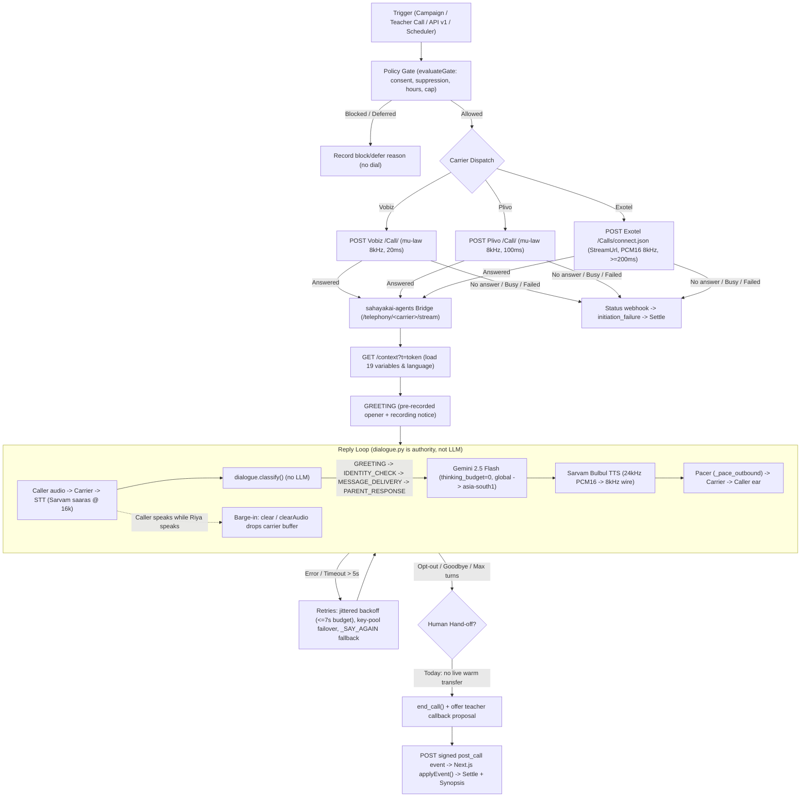
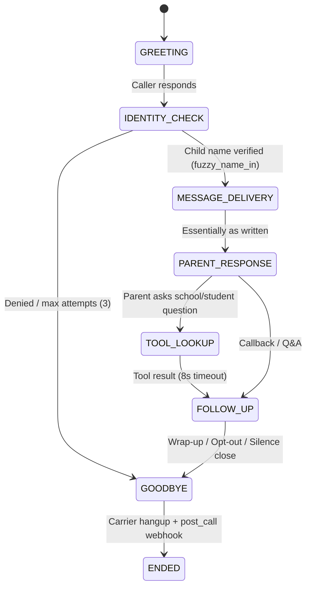

# SamparkAI Call Flow — One-Page Architecture & Lifecycle Diagram (SP-18)

**Updated:** 2026-11-28  
**Scope:** End-to-end call flow across `sahayakai-main` (Next.js) + `sahayakai-agents` (Python bridge) + carriers (`Vobiz` | `Plivo` | `Exotel`).

---

## 1. End-to-End Call Lifecycle

---

## 2. State Machine & Turn Authority (`dialogue.py`)

---

## 3. Where Exotel Diverges Today (Why Quality Drops)

1. **P0 (Resolved on `main` via PR #221):** PR #230 used `Url` (ExoML), which Exotel AgentStream ignores. `main` uses `StreamUrl` + `StreamType=bidirectional` + `Call.Status`.
2. **P1 (Audio round-trip):** Bridge runs internally on 8 kHz μ-law, forcing Exotel PCM16 audio through `PCM16 → μ-law → PCM16` on both inbound and outbound legs.
3. **P1 (Chunk padding mid-utterance):** `ExotelCodec` requires `>= 3,200` bytes (200 ms) per frame; flushing on every single empty pacer tick pads brief TTS gaps with up to 180 ms of zero-silence.
4. **Human Hand-over Gap:** Warm/live transfer to a human operator **does not exist today**—only `end_call(...)` plus scheduling a teacher callback proposal.
