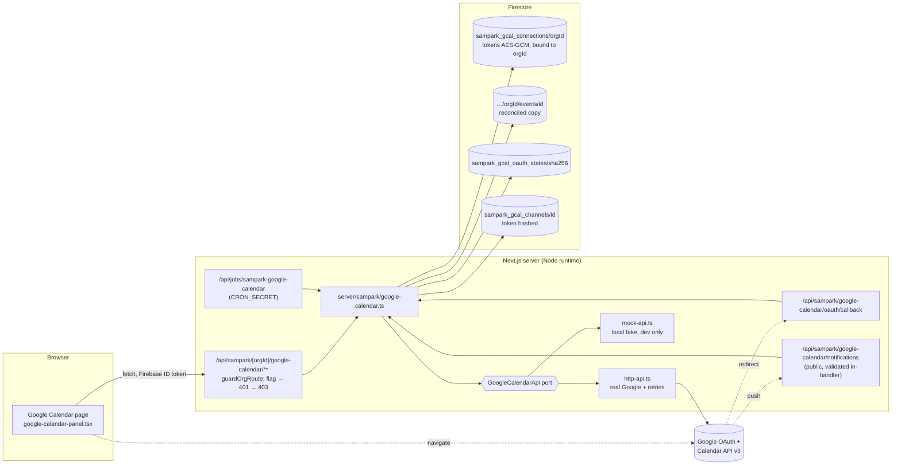

# Google Calendar for SamparkAI schools

Status (28 Oct 2026): implemented on the local branch
`feat/sampark-google-calendar-vidya-callbacks`. Tested against **mocked** Google responses
(the local fake Google and a stubbed `fetch`). **Not verified against a real Google
account**: this environment has no OAuth client. **Not verified with push notifications**:
Google cannot reach `localhost`.

Workspace → **Calendar** → **Google Calendar** (`/sampark/[orgId]/calendar/google`).

## What it does

- Connects **one Google account per school**: connect, reconnect, and a confirmed disconnect.
- Shows the connection state: not set up / not connected / connecting / connected /
  reconnect needed / error.
- Picks which calendar the school uses. Only calendars the account **owns** are listed,
  because the scope allows changing only those.
- Shows the month's events by day, with month navigation.
- Creates, views, edits and cancels events. Edits and cancellations apply to one
  occurrence or to the whole series.
- Repeats daily, weekly, monthly or yearly, every N, and ends never, after N times or on
  a date. A rule made in Google that this app cannot edit (for example `BYDAY`) is shown
  and kept unchanged.
- Shows the last sync and the push status, with a **Sync now** button.
- **A calendar event never places, schedules or cancels a phone call.** Parent callbacks
  are separate records with their own scheduler: see [CALLBACKS.md](CALLBACKS.md).

## Architecture

| Piece | File |
|---|---|
| Types, scopes, input schemas | `src/lib/sampark/google-calendar/types.ts` |
| Input → Google body, RRULE, DST | `src/lib/sampark/google-calendar/recurrence.ts` |
| Token encryption, PKCE, hashing | `src/lib/sampark/google-calendar/crypto.ts` |
| Config and mode rules | `src/lib/sampark/google-calendar/config.ts` |
| Google port, real client, fake | `api.ts`, `http-api.ts`, `mock-api.ts` |
| Storage | `src/lib/sampark/google-calendar/store.ts` |
| Service | `src/server/sampark/google-calendar.ts` |
| Routes | `src/app/api/sampark/[orgId]/google-calendar/**`, `src/app/api/sampark/google-calendar/**`, `src/app/api/jobs/sampark-google-calendar` |
| UI | `src/components/sampark/calendar/{calendar-tabs,google-calendar-panel,google-event-form}.tsx` |
| Tests | `src/__tests__/sampark/google-calendar/*` |

## Ownership and access

- **The school (tenant) owns the connection.** There is one per `orgId`, stored at
  `sampark_gcal_connections/{orgId}`.
- **Only an org admin of that school** may connect, see, change or disconnect it. This is
  the same `requireOrgAdmin` rule as every SamparkAI route.
- All admins of a school share the school's chosen calendar. Teachers do not connect
  personal calendars here.
- Every route takes the school from the URL and checks admin rights for that school.
- The OAuth callback takes the school from the **stored state**, never from the request,
  and checks admin rights again.
- Tokens are encrypted with the orgId as associated data. A token copied into another
  school's record does not decrypt.
- No browser ever receives a token. Firestore rules deny all of these collections; only
  the Admin SDK reads them.

## OAuth flow and credential storage

1. **Start.** `POST …/connect` creates a random state (32 bytes) and a PKCE verifier
   (48 bytes).
   - It stores `sha256(state)` with the orgId, the uid, the encrypted verifier, the
     redirect URI and an expiry 10 minutes out.
   - It returns Google's consent URL with `access_type=offline`, `prompt=consent`, the
     S256 challenge and the minimum scopes:
     - `calendar.events.owned`: events on calendars the account owns;
     - `calendar.calendarlist.readonly`: the list of its calendars.
2. **Google redirects** to `GOOGLE_CALENDAR_REDIRECT_URI`. That value must be HTTPS, or
   HTTP on localhost, with the exact callback path and no query string.
3. **The callback** works through these checks in order:
   - It consumes the state in a transaction: single use, unexpired.
   - It requires the signed-in uid to be the uid that started the flow (blocks login-CSRF
     and replay), and re-checks that the uid is still an admin.
   - It exchanges the code with the verifier.
   - It requires a refresh token and **both** scopes. A partial grant is revoked.
   - It stores the refresh and access tokens encrypted with AES-256-GCM under
     `SAMPARK_GCAL_TOKEN_KEY`, using the orgId as associated data.
   - It picks the owned primary calendar, or keeps the previous choice on reconnect, then
     starts push (if configured) and a first full sync.
   - It always ends with a `303` to the page with `?gcal=<outcome>`. The page shows that
     outcome in plain words and removes it from the URL. No code or token is ever echoed
     back.
4. **Refresh.** Access tokens are refreshed when fewer than 60 s remain, and once more
   after a 401. A rotated refresh token is stored.
5. **Lost access.**
   - Causes: `invalid_grant` (revoked or expired), a 401 after a refresh, or a token that
     no longer decrypts (key rotated).
   - The connection becomes `reconnect_required` and every call answers `409
     GCAL_RECONNECT_REQUIRED`. Nothing looks connected when it is not.
6. **Disconnect.**
   - Stops the push channel and revokes the refresh token at Google. An "already
     invalid" answer counts as revoked.
   - Deletes the connection and its synced copy. If Google could not confirm the
     revocation, the page says so.

## Events, recurrence and time zones

- **Reads.** Events are read live from Google for the visible month, with `singleEvents`
  expanding series into occurrences. A request may cover at most 100 days.
- **Creates are idempotent.**
  - The client sends a `requestId`. The server derives the event id as
    `sha256(orgId|calendarId|requestId)[0..32]`; lowercase hex is valid base32hex.
  - A retried create gets `409` from Google and returns the existing event, so nothing is
    duplicated.
  - Reusing a `requestId` whose event has since been cancelled is refused.
- **Timed events** are sent as wall-clock `dateTime` plus `timeZone`. Google then keeps
  each occurrence at the same local time across daylight-saving changes.
  - A wall time the zone skips (a spring-forward gap) is refused with
    `TIME_DOES_NOT_EXIST`. It is never shifted.
  - The end must be after the start, and dates must exist (for example, 30 Feb is
    refused).
- **All-day events.** The end is inclusive in the app and converted to Google's exclusive
  end.
- **Repeats** are written as an `RRULE` with `FREQ`, `INTERVAL`, `COUNT` or `UNTIL`.
  - `UNTIL` is the end of that date in the event's zone, in UTC for timed events.
  - A monthly event on the 31st skips shorter months, as RFC 5545 specifies.
- **Edit and cancel scope.**
  - `this` patches or deletes the occurrence; Google records an exception.
  - `series` acts on the master event.
  - An occurrence cannot have its own repeat rule.
  - Cancelling something already gone succeeds with `alreadyCancelled`.

## Synchronisation and push notifications

- **Incremental sync.** `events.list` runs with the stored `syncToken`, across all pages.
  - Changed events are upserted into `…/events` and cancelled ones removed.
  - The next token is stored.
  - A `410` (token expired) triggers a full sync, which resets the copy.
- **Push.** This is only on when `GOOGLE_CALENDAR_WEBHOOK_URL` is a public HTTPS URL with
  the exact notification path.
  - The channel token is stored only as a hash.
  - Channels last 7 days. The scheduler renews any channel with less than a day left:
    it creates the new one, then stops the old one.
- **A notification is not trusted on its own.** Before any sync runs, it must pass these
  checks:
  - the channel id is known;
  - the token hash matches;
  - the resource id matches;
  - the channel has not expired;
  - it is the school's current channel for the current calendar;
  - its message number is newer than the last one processed.

  A `sync` handshake is acknowledged without syncing. Otherwise the server runs an
  incremental sync **against the API**. A failed sync answers 500, so Google retries.
- **Fallback.** The scheduler job `POST /api/jobs/sampark-google-calendar` re-syncs any
  school whose last sync is older than 15 minutes. This covers missed or expired
  notifications, and it is the only automatic path on localhost. "Sync now" is the
  manual path.
- **Errors.**
  - The real client retries 429, 403 `rateLimitExceeded`/`userRateLimitExceeded` and
    5xx with exponential backoff and jitter, honouring `Retry-After`, up to 4 attempts.
  - After that, the API answers `502 GCAL_UNAVAILABLE` and records it on the connection.
  - Other errors map to plain 400, 404 or 409 answers.

## Google Cloud setup (required for real Google)

1. In the project that serves SahayakAI, go to **APIs & Services** and enable the
   **Google Calendar API**.
2. Configure the **OAuth consent screen**:
   - Set the app name, support email and authorised domain.
   - Add the two scopes above. Both are *sensitive* scopes, so production needs Google
     verification. Until then, add test users.
3. Under **Credentials**, create an **OAuth client ID** of type *Web application*:
   - Authorized redirect URI: `https://<app origin>/api/sampark/google-calendar/oauth/callback`.
   - For local testing, add `http://localhost:3005/api/sampark/google-calendar/oauth/callback`.
4. For push notifications, the notification URL's domain must be served over valid HTTPS.
   Verify it in Search Console if Google asks.
5. Store the client id, the client secret and `SAMPARK_GCAL_TOKEN_KEY` in Secret Manager.
   Expose them to the Cloud Run service as environment variables. Never commit them.
6. Add a Cloud Scheduler job: every 5–15 minutes, `POST
   /api/jobs/sampark-google-calendar` with `Authorization: Bearer $CRON_SECRET`.

## Environment

| Variable | Required | Notes |
|---|---|---|
| `GOOGLE_CALENDAR_CLIENT_ID`, `GOOGLE_CALENDAR_CLIENT_SECRET` | real Google | From the OAuth client |
| `GOOGLE_CALENDAR_REDIRECT_URI` | yes | Exact callback URL (validated) |
| `SAMPARK_GCAL_TOKEN_KEY` | yes | base64, 32 bytes. No default. Rotating it forces every school to reconnect |
| `GOOGLE_CALENDAR_WEBHOOK_URL` | optional | Public HTTPS notification URL. Unset: polling fallback only |
| `GOOGLE_CALENDAR_MODE=mock` | local only | Refused in production and without `FIRESTORE_EMULATOR_HOST` |
| `SAMPARK_ENABLED`, `CRON_SECRET` | yes | As for every SamparkAI route and job |

When anything is missing, the page shows **Not set up on this server** with the variable
**names**, never their values. Connect is not offered.

## Local testing

`node scripts/sampark/riya-local.mjs --port 3005 --ticker --admin <uid> --demo-family`

- **Without** `GOOGLE_CALENDAR_CLIENT_ID`/`_SECRET` in the shell, the app runs in **mock
  mode**, labelled "Local mock Google" on the page.
  - Connect goes straight back through the real callback with a fake code, so state,
    PKCE, encryption and storage all run.
  - Events live in the emulator (`sampark_dev_mock_google`) and support everything
    above.
- **With** them, the real OAuth client is used. Add the localhost redirect URI to the
  client first.
- The token key is generated per launch. After a restart the page shows **Reconnect
  needed** (by design).
- Push cannot be tested on localhost. Use **Sync now**, or wait for the ticker's fallback
  sync.

## Still needed before production

1. Real OAuth client, consent-screen verification and Secret Manager entries (above).
2. A connection against a real Google account, done once by a person, then the checks
   below:
   - connect;
   - choose a calendar;
   - create a weekly event;
   - edit one occurrence;
   - cancel the series;
   - disconnect;
   - confirm in Google Calendar and in the account's third-party access page.
3. The public notification URL, then a check that a change made in Google appears after a
   notification.
4. The Cloud Scheduler job.

## Known limitations

- Only calendars the account owns can be used, because the scope is
  `calendar.events.owned`. Shared calendars the account can only write to are not
  listed.
- Attendees, reminders, colours and attachments are not edited here. Google keeps them.
- The synced copy is used for change tracking and audit only. The page always reads live
  from Google.
- No external calendar feed from SamparkAI's own schedule (calls, callbacks) is written
  to Google. That would be a separate decision.
