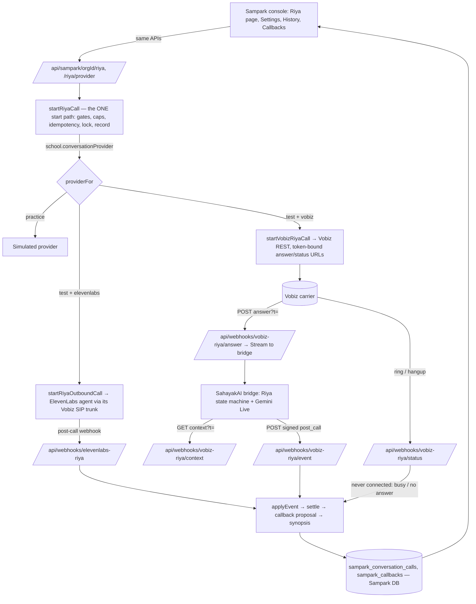

# Sampark calling: ElevenLabs Calls and Vobiz Calls behind one Riya experience

Status: implemented locally, 2026-11-09, **uncommitted** (riya-wt `develop` working tree + call-bridge-wt
`feat/parent-call-voice-upgrade`). Not deployed. No parent was called.

## What changed for a user

Settings → **Calling provider** (new card under Mode): *ElevenLabs Calls* (default) or *Vobiz Calls*.
Everything else is the existing Sampark Riya experience: the same Riya page, purpose and facts form,
preview, confirmation, call history, synopsis, collected answers, "Check status", callbacks calendar,
admin-only access, Test-mode test phone, caps and gates. Each call record shows a small provider label
(`· ElevenLabs` / `· Vobiz`). There is no separate Vobiz page, dashboard, history or API.

## Architecture

### Provider routing

| Step | ElevenLabs Calls | Vobiz Calls |
|---|---|---|
| Choice | `school.conversationProvider` missing or `'elevenlabs'` | `'vobiz'` (PUT `/riya/provider`, admin, audited) |
| Config check | `readElevenLabsConfig` → `ELEVENLABS_UNCONFIGURED` | `readVobizRiyaConfig` → `VOBIZ_UNCONFIGURED` (names only) |
| Gates, caps, lock, idempotency, test phone, roster, hours | `startRiyaCall` | **same code** (`isRealProvider`) — one daily cap across both |
| Dial | ElevenLabs SIP outbound (variables sent to the agent) | Vobiz REST; URLs carry only a token bound to `sampark~org~call` |
| Variables reach the agent | dynamic variables in the request | bridge fetches them from `/context` with a context-domain token |
| Result | ElevenLabs HMAC post-call webhook | bridge HMAC post-call event (`x-riya-bridge-signature`) |
| Ring failures | `call_initiation_failure` | Vobiz hangup never answered → `initiation_failure` |
| Reducer, settle, callback proposal, synopsis, transcript retention | `applyEvent` | **same** `applyEvent` |
| Check status | ElevenLabs conversation API | Vobiz `/Call/{uuid}` (settles only a call that never connected) |

### Files

- `src/lib/sampark/conversation/types.ts` — `'vobiz'` provider kind, `isRealProvider`.
- `src/types/sampark.ts` — `SamparkSchool.conversationProvider`.
- `src/lib/sampark/conversation/vobiz-provider.ts` — config, dial, refs, bridge signature, ring-failure map.
- `src/server/sampark/conversation.ts` — provider selection, shared real-provider rules, Vobiz dial, Vobiz reconcile.
- `src/server/sampark/vobiz-riya.ts` + `src/app/api/webhooks/vobiz-riya/{answer,status,context,event}` — the four public legs.
- `src/server/sampark/school.ts`, `src/app/api/sampark/[orgId]/riya/provider/route.ts`, `src/lib/api/sampark.ts` — the setting.
- `src/components/sampark/settings-mode.tsx` (`ConversationProviderSection`), settings page, `riya-call-panel.tsx` (provider-neutral checks + label), `src/locales/*.json` (8 strings × 10 languages).
- `src/server/sampark/callbacks.ts` — real-provider callbacks gate applies to both providers.
- `src/lib/vobiz/tokens.ts` — three new token domains.
- Class gate 2 extended (rule e): the Riya Vobiz dialler may be started only by `startRiyaCall`.
- Bridge (call-bridge-wt): `telephony/sampark_link.py`; `router.py` loads Sampark context, writes nothing to `parent_outreach` for Sampark calls, posts the signed result.
- Local proof: `scripts/sampark/vobiz-riya-e2e-server.ts` (real Sampark service on memory repos; the Vobiz REST call is captured, never sent).

### Configuration (names only)

`SAMPARK_VOBIZ_RIYA_ENABLED=true`, `VOBIZ_AUTH_ID`, `VOBIZ_AUTH_TOKEN`, `VOBIZ_FROM_NUMBER`,
`SAMPARK_PUBLIC_BASE_URL` (Vobiz calls back here), `VOBIZ_STREAM_BASE_URL` (the bridge),
`SAHAYAKAI_REQUEST_SIGNING_KEY` (shared with the bridge; also signs bridge events). Bridge:
`SAMPARK_WEB_BASE_URL` (how it reaches Sampark). All server-side; nothing reaches the browser.

## Feature-parity matrix

| Feature | ElevenLabs Calls | Vobiz Calls | Evidence | Status / limitation |
|---|---|---|---|---|
| Same Riya page, preview, confirm, history | yes | yes (same components; provider label) | panel/history tests; `riya-provider-setting.test.tsx` | ✅ |
| Provider selector | — | Settings → Calling provider (admin, audited) | 3 component tests + service test | ✅ |
| Gates (consent, suppression, hours, pause, language, custody, caps) | `startRiyaCall` | same code path | `riya-vobiz-provider.test.ts` (cap shared across providers) + all 336 existing tests | ✅ |
| Test phone / roster only, never a parent | yes | yes (same `providerFor` rules) | service tests | ✅ |
| 9 purposes, typed facts, announcement check | yes | same variables via `/context` | e2e PTM; unit: every purpose routes in the bridge | ⚠️ only PTM + behaviour exercised with audio |
| Opening, AI disclosure, good-time question | agent | bridge (cached or model-spoken) | e2e transcript | ✅ |
| Guardian verification before details | agent | bridge state machine + output guard | suite s01–s14 | ✅ |
| Callback capture → proposed callback | `callback_requested_time` | same key, collected + confirmed | e2e s07: proposed callback created | ✅ |
| Callback dispatch when due | via `startRiyaCall` | same (provider = school setting) | callbacks tests (gate generalised) | ⚠️ not run against real Vobiz |
| Stop / do-not-call | data + transcript | `stop_requested=yes` | suite s12; service test blocks callback | ✅ |
| Wrong number | agent | bridge | suite s11 | ✅ |
| Busy / no answer | initiation failure | Vobiz hangup → initiation failure | service test (USER_BUSY → busy) | ✅ |
| Transcript (opt-in, 7-day) + synopsis | yes | same reducer and retention | e2e record: transcript + final synopsis | ✅ |
| Check status | ElevenLabs API | Vobiz `/Call/{uuid}` | code + typecheck | ⚠️ not exercised against Vobiz |
| Languages | Riya speaks English; Sampark calls only English families | same gate; bridge understands short Hindi | suite: Hindi ✅, Kannada ❌ (fails safe) | ⚠️ |
| Permissions | admin-only Riya routes | same guard; provider route uses `guardRiyaRoute` | route code | ✅ (no teacher-scoped Riya calls exist for either) |
| Practice simulator | simulated | unchanged (Practice is always simulated) | existing tests | ✅ |

## Test evidence (2026-11-09)

- Jest, Sampark tree: 101 suites pass, 1 skipped (1,820 tests pass, 12 skipped). Class gate 2 extended with rule (e) and planted tests.
  Conversation + callbacks: 18 suites / 336 tests pass; new `riya-vobiz-provider.test.ts` 16/16; settings card 3/3.
- `tsc --noEmit`: clean.
- e2e (real Sampark service + real bridge + real Gemini Live, synthetic audio, no dial):
  PTM cannot-attend → `completed`, answers `{good_time_to_talk: yes, ptm_attendance: cannot_attend,
  ptm_preferred_time: Saturday morning, recipient_confirmed: yes}`, final synopsis, transcript;
  callback → `callback_requested_time: "tomorrow around 6:00 p.m."`, one PROPOSED callback.
- ElevenLabs: no code path changed except shared predicates; all existing ElevenLabs tests pass. No ElevenLabs
  call was placed today.

## Not done / needs a decision

- Production: the bridge needs a public URL (`VOBIZ_STREAM_BASE_URL`), `SAMPARK_WEB_BASE_URL`, and the signing key in
  env for the event check (`verifyBridgeSignature` reads env, not Secret Manager).
- One real test call through Sampark with Vobiz selected (allow-listed number) before any wider use.
- Branches: Sampark changes are in riya-wt (develop working tree), bridge changes in call-bridge-wt; nothing committed.

## Local real calls from the website (2026-11-09 evening)

`node scripts/sampark/riya-local.mjs --port 3000 --vobiz-call --public-base <https tunnel → :3000> --bridge-base <https tunnel → bridge> [--vobiz-allow sv-alyssa,…]`
(with `SAHAYAKAI_REQUEST_SIGNING_KEY` in the shell, shared with the bridge; Vobiz credentials read from
`VOBIZ_CRED_FILE`, never printed). The Sargvision Class (org `sargvision-local`, 9 team contacts from
`scripts/sampark/sargvision-roster.json`) is seeded in Test mode with **Vobiz Calls** selected; only the
`--vobiz-allow` contacts can ring (default Alyssa); the class roster labels every other contact "not on the call
allow-list · a call is refused"; the Riya panel says "Real-call mode is on: Vobiz Calls places this call".
Bridge: separate uvicorn on :8091 with `SAMPARK_WEB_BASE_URL=http://127.0.0.1:3000` (the emulator owns :8080).
Flow: Teacher → My classes → Sargvision Class → Call <contact> → purpose → Preview → Call Parent → confirm.

## Provider choice at the SamparkAI entry (supersedes the Settings selector)

- Every SahayakAI → SamparkAI link (`samparkEntryUrl()`: sidebar, command palette, `/attendance` on demo deployments)
  opens `/sampark/choose-provider?next=…`: two cards, ElevenLabs Calls / Vobiz Calls, nothing pre-selected.
- POST `/api/sampark/provider` (signed-in user; only providers this deployment has configured) sets the httpOnly
  session cookie `sampark_provider`. Middleware sends any workspace, school or demo page without it to the chooser
  (deep links come back afterwards). The header pill "Calls via … · Switch" returns to the chooser from anywhere.
- Server routing: the Riya routes (overview, preview, start) read the cookie into `RiyaDeps.providerChoice`;
  `selectedProvider(school, choice)` picks it over the school's stored default; every gate still applies. Each call
  record keeps the provider it used; webhooks are per provider. Scheduled callbacks use their source call's provider.
- Settings → Calling provider now shows this session's choice and "Switch provider"; the school-wide PUT route was
  removed (one mechanism). `school.conversationProvider` remains only as the fallback default (seed/launcher).
- Sargvision Class: the roster seed records `progress` consent (user confirmed the team's consent 2026-11-09), so the
  four outreach reasons pass the consent gate there; no other school's consent data or UI changed.
